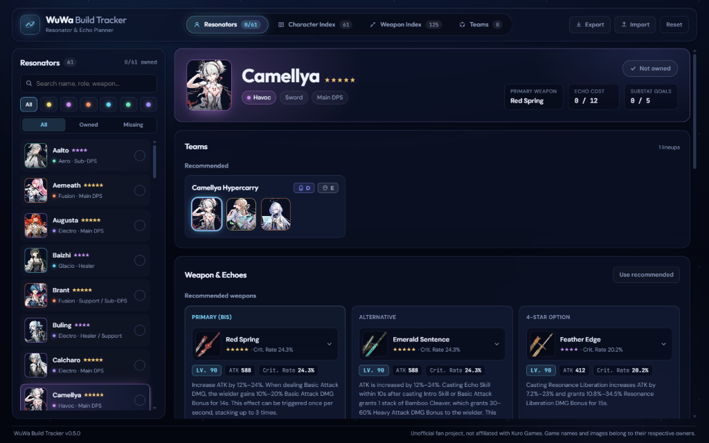

# WuWa Build Tracker

A build planner for **Wuthering Waves** as a Windows desktop app. Track your resonator builds, browse recommended weapons (with Lv. 90 main stats and a budget 4-star option), Echo sets, team lineups (`Z`–`E` tier list), and full character skills & Resonance Chain sequences—all locally on your PC.

## Features

- **Resonator Build Planner** — Track character ownership, primary/alternative/4-star weapons with Lv. 90 ATK and substat values, Echo sets, main Echoes, and Echo substat rolls.
- **Character Index** — Filter resonators by element, weapon type, or rarity and read complete **Skills** and **Resonance Chain (S1–S6)** descriptions.
- **Weapon Index** — Search and filter 125 weapons by category (`Broadblade`, `Sword`, `Pistols`, `Gauntlets`, `Rectifier`) and rarity, with Lv. 90 base stats, passives, and recommended users.
- **Teams & Tier List** — Browse recommended lineups rated from **Z** to **E** for *Tower of Adversity* and *Whimpering Wastes*, or compose and save your own teams.

Recommended builds and teams are based on [Prydwen](https://www.prydwen.gg/wuthering-waves/) (up to Version 3.7).

## Download & installation

1. **[Download the latest installer](https://github.com/Sortez/wuwa-build-tracker/releases/latest/download/WuWa-Build-Tracker-Setup.exe)** (`WuWa-Build-Tracker-Setup.exe`). That's the only file you need. What's new is listed on the [release page](https://github.com/Sortez/wuwa-build-tracker/releases/latest).
2. Run the installer.
   - Windows may show "Windows protected your PC" because the app isn't commercially code-signed. Click **More info → Run anyway**.
3. Done. Requires Windows 10 or 11.

## Updates

The app checks for a new version on startup and offers to install it with one click. Your progress is kept.

## Your data

Everything is stored locally on your PC (`%APPDATA%\com.wuwa.buildtracker\wuwa-state.json`). There's no account and no server. Use **Export backup** in the top bar to save your progress to a file, and **Import backup** to restore it, for example on a new PC.

---

Unofficial fan project, not affiliated with Kuro Games. Game names and images belong to their respective owners.
